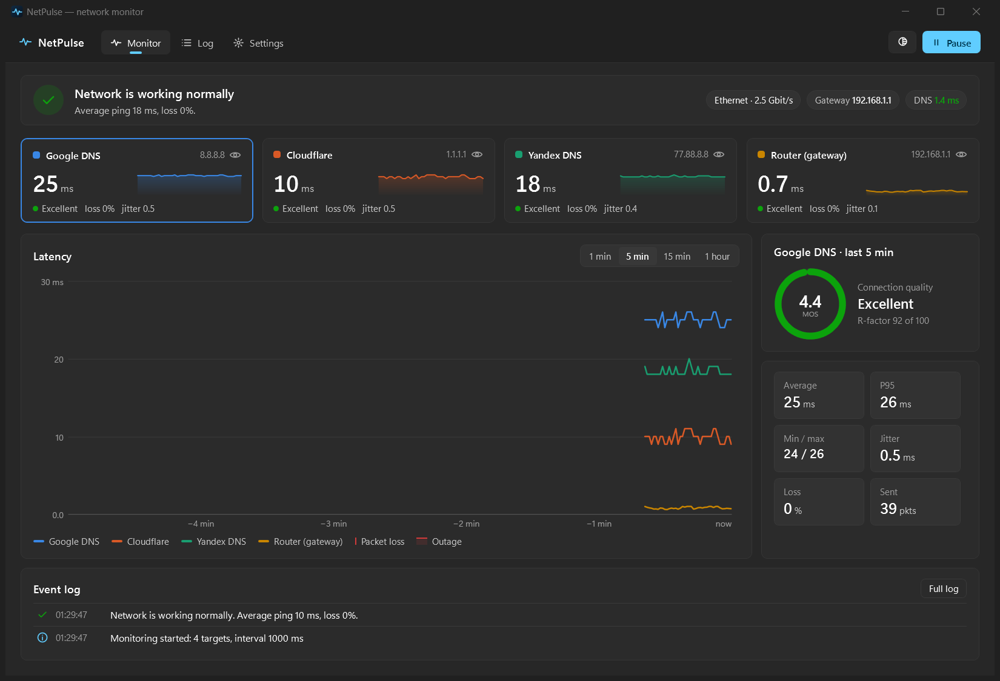
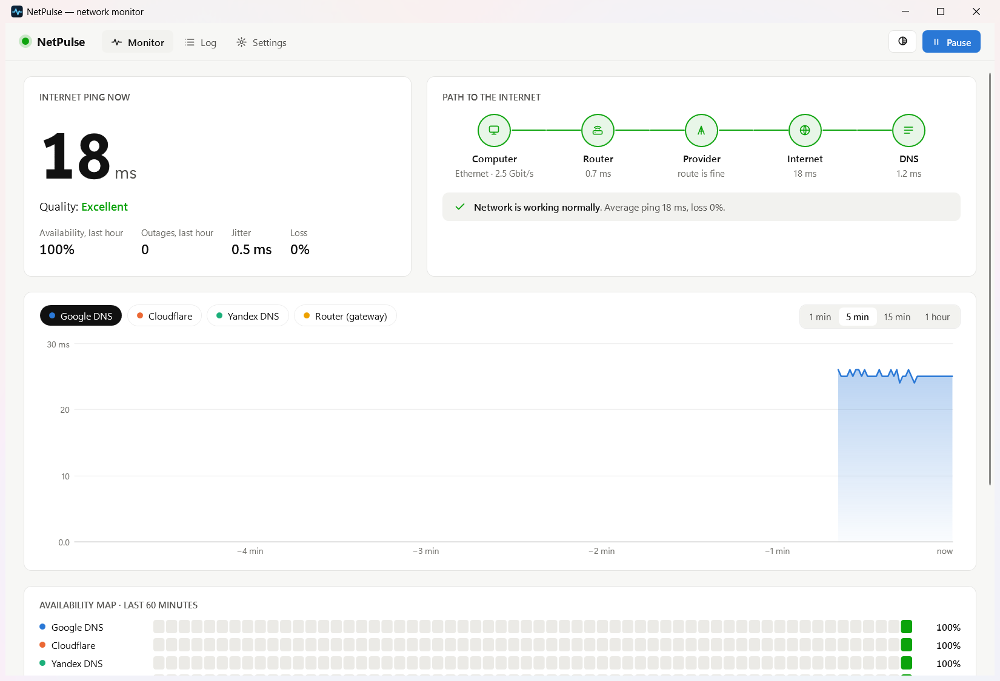
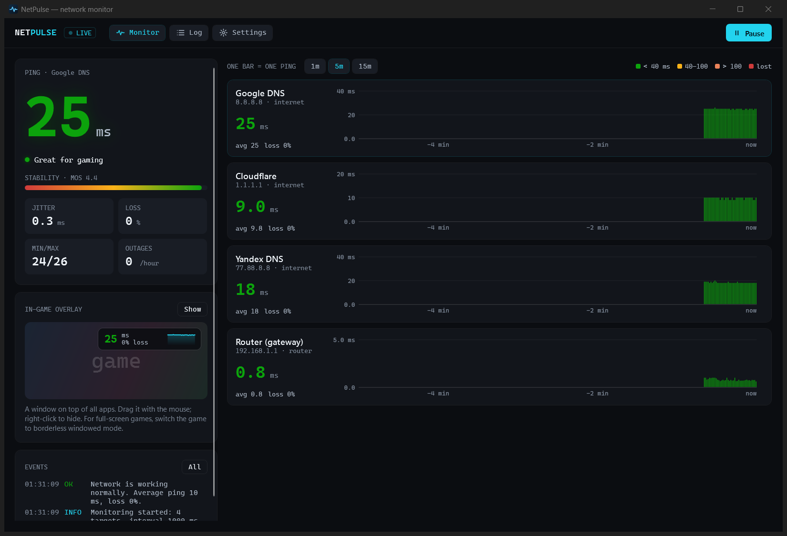

# NetPulse

**Network quality monitor for Windows 10/11.** NetPulse pings several hosts continuously, draws a live
latency chart, detects outages, packet loss and lag spikes, and tells you *where* the problem is:
your router, your provider or DNS.

**[⬇ Download the latest version](https://github.com/zemidala/NetPulse-releases/releases/latest)**: take `NetPulse-<version>-win-x64.zip`, unzip and run `NetPulse.exe`. No installation and no .NET required.

English and Russian interface · Русский интерфейс — [see below](#русский)

## Features

- **Live latency chart** of several targets at once (Google DNS, Cloudflare, Yandex DNS and your router by default; add your own). Pick how it looks: line, area, steps, stems, bars, range band, SmokePing-style smoke, dots or a heatmap; add spike labels, a logarithmic scale or good / bad zones.
- **Outage detection**: N lost pings in a row start an outage, M replies end it; each outage is logged with its duration.
- **Connection quality** from the ITU-T E-model: R-factor and MOS, plus jitter, P95 and loss.
- **Where is the problem?** The “PC → router → provider → internet → DNS” path highlights the failing link.
- **DNS check** with a direct query to your DNS server, bypassing the Windows cache.
- **Three layouts** switchable on the fly: *Fluent* (Windows 11 style), *Focus* (large figures and an availability map), *Pulse* (gaming style with one bar per ping).
- **Overlay**: an always-on-top window with the current ping and the same chart as the main window. Resize it by the corner; it sticks to screen edges.
- **Tray icon** colored by network state, notifications on outages and recovery, start with Windows.
- **Event log** in CSV, export of all measurements to Excel.
- Light and dark themes, update check.

| Focus | Pulse |
|---|---|
|  |  |

## Install

1. Download `NetPulse-<version>-win-x64.zip` from [Releases](https://github.com/zemidala/NetPulse-releases/releases/latest) and unzip it to any folder.
2. Run `NetPulse.exe`. The app is not code-signed yet, so Windows SmartScreen may warn you: click **More info → Run anyway**.
3. To update, exit NetPulse and replace `NetPulse.exe` with the new one (the bare exe is attached to every release too). Settings stay.
4. Settings are stored in `%APPDATA%\NetPulse`. To uninstall, delete the exe and that folder.

The *Source code (zip / tar.gz)* links on a release are added by GitHub automatically. NetPulse is closed source, so they contain only this README, not the program.

## Feedback

- 🐞 Found a bug or want a feature? [Open an issue](https://github.com/zemidala/NetPulse-releases/issues/new/choose).
- 💬 Questions, ideas, your setups — [Discussions](https://github.com/zemidala/NetPulse-releases/discussions).

English or Russian — both are fine.

---

## Русский

**Монитор качества сети для Windows 10/11.** NetPulse непрерывно пингует несколько узлов, рисует живой
график задержки, находит обрывы, потери пакетов и скачки пинга и показывает, *где* проблема:
в роутере, у провайдера или в DNS.

**[⬇ Скачать последнюю версию](https://github.com/zemidala/NetPulse-releases/releases/latest)**: возьмите `NetPulse-<версия>-win-x64.zip`, распакуйте и запустите `NetPulse.exe`. Без установки, .NET не нужен.
Язык интерфейса переключается в **Settings → Appearance → Language → Русский**.

Возможности:

- живой график задержки нескольких целей сразу, девять видов на выбор (линия, заливка, столбики, «дым» как в SmokePing, точки, тепловая карта и другие), подписи пиков, логарифмическая шкала, зоны «хорошо / плохо»;
- обнаружение обрывов с длительностью и числом потерянных пакетов;
- оценка качества связи по E-model (R-фактор, MOS), джиттер, P95, потери;
- цепочка «ПК → роутер → провайдер → интернет → DNS» с подсветкой проблемного звена;
- проверка DNS прямым запросом в обход кэша Windows;
- три шаблона экрана: Fluent, Focus и игровой Pulse;
- оверлей поверх окон с текущим пингом и тем же графиком, что в главном окне (прилипает к краям экрана), значок в трее, уведомления, автозапуск;
- журнал событий в CSV и экспорт замеров в Excel.

Установка: скачайте архив `NetPulse-<версия>-win-x64.zip`, распакуйте в любую папку и запустите `NetPulse.exe`. Программа пока
не подписана цифровой подписью, поэтому Windows SmartScreen может показать предупреждение: нажмите **Подробнее → Выполнить в любом случае**.
Обновление: выйдите из NetPulse и замените `NetPulse.exe` новым, настройки сохранятся. Архивы *Source code* в релизе GitHub добавляет
сам, программы в них нет.

Нашли ошибку — [создайте issue](https://github.com/zemidala/NetPulse-releases/issues/new/choose); вопросы и идеи — в [Discussions](https://github.com/zemidala/NetPulse-releases/discussions).
